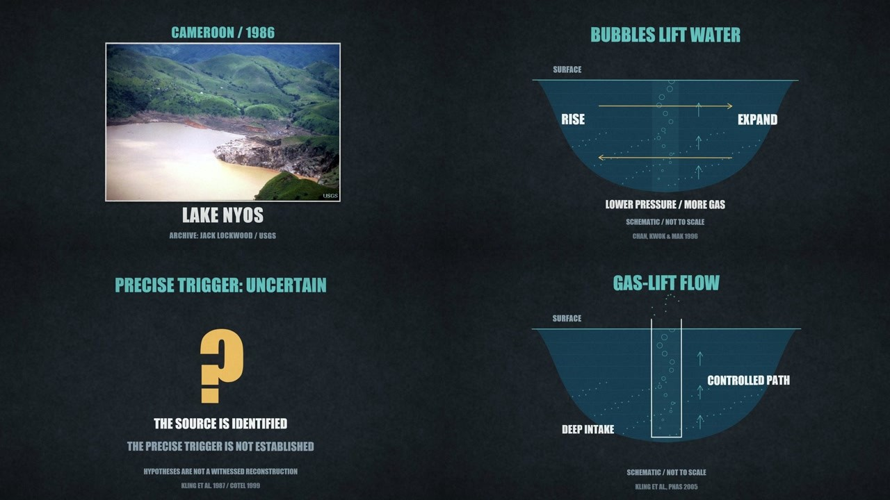
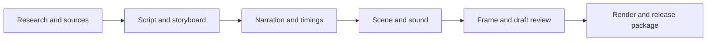

# Cinematic Documentary Studio

**Create animated documentaries with code, local narration, and a repeatable production process.**

An agent-assisted studio for researching a story, writing its script, recording narration, building timed animation, and preparing a YouTube release package. The core workflow uses Python and Skia through [Cinematic Skill](https://github.com/Moh4696/cinematic-skill), with local Kokoro narration and Faster Whisper alignment. Setup entry points are included for Windows PowerShell, macOS/Linux zsh, and bash. HyperFrames is available as an optional HTML-video workflow.

The local production runtime uses free tools and requires no paid generation API. Your chosen AI coding assistant is separate and may require its own subscription.



*Lake Nyos pilot — 5 minutes 29 seconds, 1920×1080 at 30 fps. Original scene graphics with credited archival imagery. See [media and software credits](THIRD_PARTY_NOTICES.md).*

## What you can build

| Capability | Included approach |
| --- | --- |
| Research and scripting | Claim/source records, scripts, storyboards and timed beat tables |
| Local narration | Kokoro ONNX; continuous chapter takes with selectable voices and pacing |
| Narration alignment | Faster Whisper word timestamps, with approximate timing clearly identified |
| Animated scenes | Python/Skia camera moves, archival photos, maps, diagrams, labels and visual accents |
| Sound | Synthesized effects and narration-first loudness mixing |
| Reliable exports | CPU rendering, bounded encoders and resumable four-second sections for the pilot |
| Release preparation | English SRT captions, chapter timestamps, description, thumbnail designs and source credits |
| Optional YouTube tools | Account verification, private uploads, metadata, captions and basic analytics |

This is a production toolkit and a worked example. New documentaries need their own research, writing, scene design and editorial review. Source attribution, narration quality and factual accuracy remain part of the work.

## Quick start

**Tested baseline:** Windows, Python 3.11, approximately 16 GB RAM. Rendering uses the CPU; begin with two workers on a new machine. Git is required. Node.js 22.20+ is optional for HyperFrames.

Clone the repository:

```sh
git clone https://github.com/AashishKumar-3002/cinematic-documentary-studio.git
cd cinematic-documentary-studio
```

**Windows / PowerShell:**

```powershell
powershell -NoProfile -ExecutionPolicy Bypass -File tools/setup.ps1
. ./tools/env.ps1
./tools/setup.ps1 -CheckOnly
```

**macOS or Linux / zsh:**

```zsh
zsh tools/setup.zsh
source tools/env.zsh
zsh tools/setup.zsh --check-only
```

**macOS or Linux / bash:**

```bash
bash tools/setup.sh
source tools/env.sh
bash tools/setup.sh --check-only
```

The Unix scripts require Python 3.11+, FFmpeg and FFprobe already on PATH or under `tools/bin`. They never invoke `sudo`, `apt` or `brew`. See the [platform prerequisites](docs/SETUP.md) before running them. Windows is the fully tested production platform; Unix shell checks and runtime lookup tests have been run on Ubuntu, while a complete macOS/Linux film build is not yet verified.

Setup creates project-local dependencies, verifies and downloads the Kokoro model/voices, and prepares FFmpeg/FFprobe. The two narration files total about 354 MB; additional runtime downloads may be needed. Existing system Python is reused. No global Python or Node packages are installed by the bootstrap.

Generate a narration sample:

```powershell
python tools/narrate.py "Every extraordinary story begins with a question." --output output/sample.wav
```

The default narrator is `af_heart`, selected during the pilot review. Models and caches remain inside the project. See [installation details and troubleshooting](docs/SETUP.md).

## Run the example

The [Lake Nyos guide](docs/PILOT.md) covers the complete build, including downloads and review steps. Its main stages are:

```powershell
. ./tools/env.ps1
python tools/build_nyos_story.py
python tools/build_nyos_full_audio.py
python tools/prepare_nyos_full_assets.py
```

Then fetch and prepare the credited photographs, review the animation, build the soundtrack and export using the commands in the guide:

```powershell
python tools/render_nyos_checkpointed.py --workers 2
python tools/package_nyos_release.py
python tools/verify_nyos_delivery.py
```

Generated films go to `projects/lake-nyos/film/out/`; release files go to `projects/lake-nyos/film/release/`. Those files are excluded from Git. A fresh clone regenerates them.

The checkpoint runner resumes unchanged inputs by validating section frame counts. It does not fingerprint scene changes: move old checkpoints aside before rebuilding edited scenes, assets or timings. The pilot verification script contains its original expected frame count; adapt it when changing the film's length.

## Production workflow



[Cinematic-film](.agents/skills/cinematic-film/SKILL.md) is the primary workflow. It is included with its upstream MIT licence and attribution. The [production playbook](.agents/skills/documentary-production-playbook/SKILL.md) carries forward lessons from the pilot:

- Write for curiosity, concrete stakes and a clear payoff; review the delivery as well as the facts.
- Match spoken points to highlights, circles, arrows, reveals and other explanatory visual actions.
- Give important moments, writing and transitions purposeful sound while keeping narration clear.

Tutorial techniques are flexible references. The pilot is a learning example, and its feedback informs future films rather than implying measured audience-growth results.

## Optional tools

```powershell
./tools/setup.ps1 -WithHtml       # HyperFrames, GSAP and Three.js
./tools/setup.ps1 -WithResearch   # Scrapling, yt-dlp and a local Chromium browser
```

All **18 project skills** are bundled under [`.agents/skills/`](.agents/skills), including Open 3D, HyperFrames, Learn, Last30Days, Scrapling and the saved animation/editing references. See the [skill catalogue and setup commands](docs/SKILLS.md) for each skill's purpose, provenance and prerequisites. Skill instructions do not automatically install every optional provider integration or grant access to authenticated/paid sources. Personal learning archives and reference PDFs remain outside the distribution.

YouTube integration is separate. Each user connects their own account and verifies the intended channel. Cloning, setup and local rendering do not authenticate, upload or publish. See [publishing setup](docs/PUBLISHING.md).

## Repository layout

```text
.agents/skills/          All 18 project skills, source scripts and licence notices
docs/                   Setup, pilot rebuild and publishing documentation
projects/lake-nyos/      Example script, sources, storyboard, scene and feedback
projects/studio-test/    Optional HTML composition smoke test
tools/                  Narration, preparation, rendering and publishing helpers
requirements.txt        Direct dependencies for the native workflow
requirements-*.txt      Optional packages and original environment snapshots
package-lock.json       Locked optional HTML-tool dependencies
```

Models, virtual environments, binaries, credentials, downloaded transcripts, reference PDFs, render checkpoints and completed media stay local. The source repository includes only a small preview image for documentation.

## Validation and contributions

```powershell
python tools/check_repository.py
python -m unittest discover -s tools/tests -v
```

The publication check validates Python/JSON, source file sizes, common credential patterns and excluded paths. The existing YouTube tests use mocked services; they do not prove live account access. The optional GitHub Actions workflow runs these checks after code changes. It does not render or publish anything.

The pilot was completed and verified on the original Windows workstation. A full end-to-end rebuild on a separate clean machine has not yet been verified. More platform coverage, expressive narration and richer synchronized visual/sound interaction are areas for future improvement. Contributions are welcome; see [CONTRIBUTING.md](CONTRIBUTING.md).

## Licence and acknowledgements

Original studio contributions are [MIT licensed](LICENSE). Third-party code, models and media retain their own terms; see [THIRD_PARTY_NOTICES.md](THIRD_PARTY_NOTICES.md).

Special thanks to [Moh4696/cinematic-skill](https://github.com/Moh4696/cinematic-skill), copyright exploraX, for the primary engine; and to the maintainers of Kokoro ONNX, Faster Whisper, Skia Python, FFmpeg, HyperFrames and the other dependencies. Archive sources include USGS, NASA/Goddard SVS and Natural Earth. This project is independently maintained and is not affiliated with those organizations.
